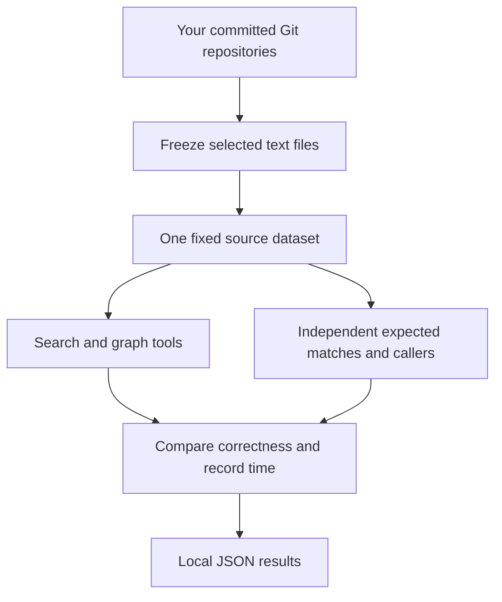

# Search benchmark

Measure whether a code search returns the right matches, then measure how long it takes. This project compares ripgrep, BSD/GNU grep, ugrep, fff, ast-grep, codebase-memory-mcp, and Graphify on the same committed source files.

[Results](#reported-results) · [Quick start](#quick-start) · [October report](docs/REPORT-2026-10-15.md) · [MIT license](LICENSE)

## Reported results


The October 15 run used **33 repositories and 15,595 committed files**, with one warm-up and seven measured repetitions per query.

| Tool | Exact queries | Median ms | p95 ms |
| --- | ---: | ---: | ---: |
| fff SDK | 35/35 | 4.64 | 64.78 |
| fff MCP | 26/35 | 5.15 | 107.86 |
| ugrep | 35/35 | 169.46 | 249.12 |
| ripgrep | 35/35 | 202.00 | 300.61 |
| GNU grep | 35/35 | 502.57 | 702.94 |
| BSD grep | 35/35 | 1068.05 | 1500.09 |

Both graph tools matched all **12 same-file caller sets**. Codebase-memory found **27/30** symbol targets and Graphify found **26/30**. Ast-grep matched **12/12** separate syntax-pattern tasks.

Compare correctness before speed. The SDK retains an in-process index, CLI timings include startup, and fff MCP has different search semantics. This private dataset and shared workstation do not establish a general winner. The [October report](docs/REPORT-2026-10-15.md) includes graph timings, limits, installation controls, and [exact tool versions](docs/versions-2026-10-15.json).

Use **ripgrep and codebase-memory together** for complementary tasks: exact text and source verification with ripgrep; indexed symbols and relationships with codebase-memory. This run did not measure a combined workflow or a productivity gain.

## September historical results


These numbers come from the **September 2026 report**, not a new test run. The experiment used 29 repositories and 11,488 files on one macOS workstation. The original source dataset and raw results are not published, so this repository does not let readers independently verify these historical measurements.

- **Exact text matches:** ripgrep, grep, and fff SDK returned all expected query sets. fff MCP returned 24 of 31, so its time does not represent complete exact search.
- **Search time:** fff SDK had the lowest reported median on this workload. It kept an index in the Python process; CLI timings included process startup and output parsing.
- **Caller relationships:** both graph tools found all 12 expected caller sets. The test only covered direct calls between top-level Python functions in the same file.
- **Limits:** the later [agent follow-up](docs/AGENT-SEARCH.md) found fff SDK whitespace and cold-start problems. This small experiment does not establish a general winner.

See the [full report](docs/REPORT.md) for repetitions, tail latency, tool versions, and model experiments. Read the [methodology notes](docs/RESEARCH.md) before comparing tools.

## How the benchmark works



The public repository contains scripts, setup instructions, and historical reports. You provide the source repositories. Generated source copies, indexes, and model conversations stay local and are ignored by Git. The MIT license covers the benchmark scripts, not your source data or third-party tools.

## Share the findings

Share [the repository](https://github.com/BeLazy167/search-benchmark), the [October result image](docs/assets/results-2026-10-15.png), or the [October report](docs/REPORT-2026-10-15.md). Keep the timing and private-data limits with the numbers. Suggested text:

> We refreshed our open-source code-search benchmark on 33 repositories and 15,595 committed files. Five exact-search tools matched all 35 query sets; fff MCP matched 26. Both graph tools matched all 12 tested same-file caller sets. Tools answer different questions and have different timing boundaries. The scripts and aggregate results are public; source data and raw evidence remain private. https://github.com/BeLazy167/search-benchmark

## Requirements

The full tool setup targets **macOS on Apple Silicon**. Several runners use `/usr/bin/sandbox-exec` to deny network access to search processes. Linux and Windows need different release artifacts and an equivalent sandbox before those runners will work.

Install Git, Python 3.13, [uv](https://docs.astral.sh/uv/), and Apple's command-line developer tools for the optional source builds.

`bootstrap.py` installs the pinned macOS arm64 releases in [tool-lock.json](tool-lock.json): ripgrep 15.2.0, fff SDK/MCP 0.11.0, codebase-memory-mcp 0.12.0, ast-grep 0.51.0, and Graphify 0.9.91 at an exact commit. Downloads are checked against recorded hashes. Graphify dependencies use `graphify/requirements.lock`. `install_extra_tools.py` builds GNU grep 3.12 and ugrep 7.8.5 from verified official source archives with networking denied. These installs stay inside the checkout. BSD grep comes with macOS and is not independently upgraded.

These were the latest stable releases checked on October 15, 2026. Pins deliberately preserve that run; they do not silently track future releases. See [tool research](docs/TOOLS-2026-10-15.md) and [tested versions](docs/versions-2026-10-15.json). Checksums verify download integrity, not the absence of malicious behavior.

## Quick start

```sh
cd "$(mktemp -d /tmp/search-benchmark.XXXXXX)"
git clone https://github.com/BeLazy167/search-benchmark.git
cd search-benchmark
python3 bootstrap.py
python3 install_extra_tools.py
```

Place the Git repositories to benchmark under one directory, for example:

```text
/path/to/repos/
  project-a/.git
  project-b/.git
```

Use a dedicated input directory. Each repository needs a commit. Preparation reads committed files with `git archive`; it does not run their code or include uncommitted changes.

```sh
graphify/.venv/bin/python prepare.py --root /path/to/repos
graphify/.venv/bin/python build_relationships.py
python3 offline.py graphify/.venv/bin/python text_bench.py --smoke --repeats 1
```

The smoke run checks the first two literal queries. Run the full literal workload with:

```sh
python3 offline.py graphify/.venv/bin/python text_bench.py --repeats 7 \
  --ugrep tools/ugrep/bin/ugrep --gnu-grep tools/grep/bin/grep
```

`offline.py` denies network and home-directory access and strips inherited credentials. Keep this temporary benchmark checkout outside your home directory, such as under `/tmp`, because the sandbox also denies access to benchmark files placed under your home. Codebase-memory needs `--local-ipc` for its isolated Unix socket; IP networking remains denied.

Results go to `text-results.json`. Each trial records elapsed milliseconds, exact-match status, false positives, false negatives, and output size. Trial `-1` is warm-up. The terminal prints median latency and exact-match counts for each tool.

`prepare.py` creates `corpus/`, `manifest.json`, `queries.json`, and `symbols.json`. It excludes hidden paths, common dependency/build directories, symlinks, submodules, common credential filenames, non-UTF-8 files, and files larger than 1 MiB. These filters are not a secret scanner. Keep generated outputs private unless you have reviewed their contents and have permission to publish the input code.

Preparation refuses to overwrite an existing corpus. Use a fresh clone for a different dataset. To reconstruct recorded commits in another output directory:

```sh
graphify/.venv/bin/python prepare.py \
  --root /path/to/repos \
  --manifest manifest.json \
  --output /tmp/search-benchmark-rebuilt
```

The source repositories must still contain the recorded commits; this command does not fetch them.

## Additional reusable benchmarks

Run these after preparation and tool setup:

```sh
# fff's persistent MCP interface, including pagination
python3 offline.py graphify/.venv/bin/python fff_mcp_bench.py --repeats 7

# AST graph indexing and symbol/caller queries
python3 offline.py --local-ipc graphify/.venv/bin/python codebase_bench.py --repeats 7

# Graphify indexing, then queries against the saved graph
python3 offline.py graphify/.venv/bin/python graphify/run.py --output graphify/run-hcl
python3 offline.py graphify/.venv/bin/python graph_queries.py --repeats 7

# Syntax patterns, scored separately from resolved callers
python3 offline.py graphify/.venv/bin/python ast_bench.py --repeats 7

# Export only numeric aggregates after all required runs have finished
python3 publish_results.py --root . --output /tmp/public-results.json
```

Graphify needs a fresh output directory for an initial index. Pass `--skip-index` to its runner to reuse an existing graph. The caller oracle selects up to 12 examples, with at most two per input repository. A corpus without suitable Python functions can produce no caller tasks.

## Experimental and dataset-specific scripts

The remaining scripts preserve the original research workflow. They are starting points for adaptation, not a portable one-command benchmark:

| Scripts | What needs adapting |
| --- | --- |
| `fuzzy_bench.py` | The six typo queries and target paths refer to the original qBraid corpus. |
| `run_all.py` | Calls the dataset-specific fuzzy benchmark; use the individual runners above for a new dataset. |
| `qa_pilot.py`, `prepare_qa_evidence.py`, `targeted_evidence.py` | The model pilot selects specific caller task IDs. Choose IDs present in your generated `relationships.json`. |
| `agent_search_bench.py` | Its smoke check includes an original corpus path; its ripgrep subprocess expects `/opt/homebrew/bin/rg`. |
| `proxy_client.py`, `luna.py` | Expect a local CLIProxy endpoint and configuration at `~/.cli-proxy-api/config.yaml`. Review the model and endpoint before use. |
| `summarize.py`, `verify.py` | Expect a complete set of original experiment artifacts and include original dataset assumptions. |
| `agent_search_replay.py`, `verify_agent_search.py` | Require saved agent trials; they cannot validate absent historical results. |
| `agent_search_bench_before_scope_fix.py` | Historical version retained for comparison; use `agent_search_bench.py` for new work. |

Model experiments send source excerpts to the configured provider and may incur charges. The quick start makes no model requests. Raw model outputs and graph evidence can contain input source code.

## Interpreting results

Compare correctness before latency. fff MCP's smart-case/fuzzy behavior and per-file match limits differ from exact grep. The SDK runner explicitly requests case-sensitive plain matches and consumes pagination.

Timing boundaries differ: grep and ripgrep include process startup and output parsing, while the fff SDK keeps an in-process index. Graphify query timing excludes graph loading and MCP transport. Index-build times are separate from query times. Warm runs do not represent cold disk access.

The caller oracle only covers direct named calls between top-level Python functions in the same file. It excludes nested scopes and does not resolve imports, aliases, callbacks, or dynamic dispatch. Small model experiments do not establish general coding productivity.

## October verification

All nine tool/interface configurations completed the offline benchmark. All 33 unit tests, a clean-destination bootstrap, public fixtures, corpus hash verification, and the staged-publication secret scan passed. See the [October verification record](docs/REPORT-2026-10-15.md#verification).

## Historical release verification

A clean bootstrap, all four unit tests, a two-query literal smoke run, fff MCP, and Graphify indexing/querying passed on a small committed Python sample on macOS arm64. The codebase-memory runner was blocked by the installed 0.11.0 daemon/cache restriction described above. Model requests and the full private-corpus experiment were not rerun.

## Development

After bootstrap, run the existing unit checks:

```sh
python3 -B -m unittest test_harness test_ast_bench test_publish_results test_codebase_adapter
```

Changes to a runner should include a small corpus check and state the tool versions used. Open an issue or pull request with the command, platform, versions, and a minimal public sample. Do not attach private source or credentials.

## License

[MIT](LICENSE). Third-party tools retain their own licenses and are downloaded separately.
