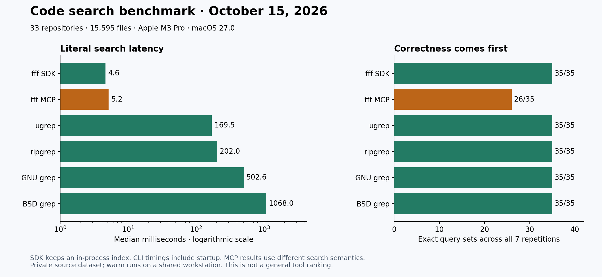

# October 2026 benchmark refresh

This run measures selected search tasks on a frozen private source corpus. It does not measure coding productivity or establish a universal tool ranking. The September reports remain historical records, and the new corpus is different, so changes between reports are not paired version comparisons.

## Results

| Tool | Exact queries | Median ms | p95 ms |
| --- | ---: | ---: | ---: |
| fff SDK | 35/35 | 4.64 | 64.78 |
| fff MCP | 26/35 | 5.15 | 107.86 |
| ugrep | 35/35 | 169.46 | 249.12 |
| ripgrep | 35/35 | 202.00 | 300.61 |
| GNU grep | 35/35 | 502.57 | 702.94 |
| BSD grep | 35/35 | 1068.05 | 1500.09 |

| Tool | Symbol targets found | Caller sets exact | Symbol median ms | Caller median ms | Initial index s |
| --- | ---: | ---: | ---: | ---: | ---: |
| codebase-memory-mcp | 27/30 | 12/12 | 14.96 | 29.24 | 58.08 |
| graphify | 26/30 | 12/12 | 113.37 | 656.96 | 134.82 |

Ast-grep matched all 12 syntax-pattern query sets, with a median of 10.25 ms and p95 of 12.89 ms. Graphify's unchanged-index pass took 46.24 seconds. All exact text tools returned zero false positives and false negatives. Across seven measured repetitions, fff MCP returned 1,302 false positives and missed 375,823 expected line matches.

The [machine-readable aggregates](results-2026-10-15.json) are the source for the chart and tables. The private raw evidence is not published, so readers cannot independently reproduce these particular measurements without the original dataset. Use the scripts with your own permitted corpus.

## Dataset and machine

The corpus contains 33 committed repositories, 15,595 UTF-8 files, and 125,210,327 bytes. Preparation uses committed HEADs and excludes uncommitted work. A secret scan flagged 106 files, which were conservatively excluded. A second scan reported zero findings. This does not prove that the remaining corpus contains no sensitive data; the entire corpus stays private.

The host is an Apple M3 Pro with 12 logical CPUs and 18 GiB RAM, running macOS 27.0 build 26A428 on arm64. Python is 3.13.1. The workstation had unrelated activity. Benchmark runners ran sequentially, without terminating other sessions or clearing shared caches. Results represent warm filesystem access, not controlled cold-disk performance. Peak memory, regex search, fuzzy file discovery, and end-to-end agent productivity were not measured.

## Tested tools

| Tool | Version | Interface |
| --- | --- | --- |
| ripgrep | 15.2.0 | Fresh CLI process per query |
| BSD grep | 2.6.0-FreeBSD | macOS-supplied CLI |
| GNU grep | 3.12 | Fresh CLI process per query |
| ugrep | 7.8.5 | Fresh CLI process per query |
| fff | 0.11.0 | Persistent Python SDK and separate persistent MCP runs |
| codebase-memory-mcp | 0.12.0 | Isolated daemon, full index, LSP disabled, persistent MCP |
| Graphify | 0.9.91 | AST-only index, no clustering or LLM pass; in-process query function |
| ast-grep | 0.51.0 | Python named-call syntax patterns through CLI |

[Exact versions and executable hashes](versions-2026-10-15.json), [download pins](../tool-lock.json), and [release research](TOOLS-2026-10-15.md) record provenance. Graphify uses commit `10130e79ed9caf8f60d998073e097531eaa1a395`; its Python dependencies are frozen in [requirements.lock](../graphify/requirements.lock). Tools considered but not exercised receive no score.

## Timing and correctness

Every query has one unscored warm-up followed by seven measured repetitions. Median and p95 pool measured query executions; p95 uses the nearest-rank method. A query counts as exact only if every measured repetition returns the expected set. False-positive and false-negative totals for text and syntax matching sum all measured repetitions.

Literal search has 35 case-sensitive query sets, checked against independently computed file/line matches. CLI timings include process startup, output capture, and parsing. The fff SDK retains an in-process index; its startup/index cost is outside query timing. fff MCP includes transport and pagination but uses smart-case, fuzzy fallback, and output limits, so its latency cannot stand for complete exact search. Its corpus copy is outside the benchmark Git checkout because fff otherwise searches the containing Git root. Copy preparation is excluded from timings.

Graph symbol checks ask whether the expected file is found, not whether every returned symbol is correct. Codebase-memory includes MCP transport and result normalization; Graphify loads its graph once and calls the query implementation in-process, excluding MCP transport. Caller timings include target lookup for codebase-memory. Same-file caller correctness compares final saved evidence for 12 tasks against an independent Python AST oracle. It is not validated separately for every timed repetition. Graphify caller correctness checks stored directed call edges rather than the ranked prose query response.

The caller oracle covers direct named calls between top-level Python functions in one file. It does not evaluate imports, aliases, nested functions, callbacks, dynamic dispatch, or cross-repository resolution. Ast-grep has a separate 12-task syntax test: all named call expressions in the selected files, including nested scopes, compared by exact byte ranges against Python's AST. Syntax-pattern matches are not resolved caller relationships.

The fff SDK initial scan took 0.519 seconds; fff MCP initialization took 0.021 seconds. These are separate startup boundaries, not equivalent complete-index measurements. Graphify graph loading took 1.719 seconds before its timed queries.

## Privacy and installation controls

Official release assets were checked against GitHub release digests; source archives were checked against recorded Homebrew formula hashes. Source builds ran with networking denied and without inherited credentials. No downloaded shell installer or assistant hook was run. These checks establish provenance and integrity, not proof that software is harmless.

All private-corpus benchmark commands use `offline.py`, which removes inherited credentials and denies home-directory access. The default profile denies networking. Codebase-memory additionally needs Unix sockets, so its profile denies IP networking while permitting local IPC. An independent connection test confirmed IP access was denied. Its runtime and cache are separate from existing account daemons; cleanup addresses only that private runtime. No model benchmark sent private corpus source to a provider.

The public exporter constructs a fresh allowlisted object containing numeric aggregates. It does not copy input records. Source files, repository identities, commit hashes, paths, queries, symbols, graph evidence, logs, and model messages are excluded. Tool hashes are public provenance and are distinct from private source hashes.

## Using ripgrep with codebase memory

Use ripgrep for exact text, configuration values, error messages, and confirmation in source. Use codebase-memory for indexed symbols and relationships, then verify the relevant source with exact search or snippets. The tasks are complementary. This benchmark does not time a combined workflow and therefore cannot claim a measured productivity gain from using both together. Refresh the graph when code changes, and treat missing graph results as a reason to fall back to source search.

## Verification

All nine tested tool/interface configurations completed their runs. The 33 unit tests passed, along with a standalone fff MCP public fixture and a preparation/reconstruction fixture proving that reviewed exclusions persist. Bootstrap succeeded in a clean destination using checksum-verified cached release downloads and a newly created Python environment. The extra source-built tools were compiled locally before the measurements.

The final corpus inventory and every recorded file hash remained unchanged. The staged public tree passed a redacted gitleaks scan with zero findings. A comparison of staged additions against private source paths, source commits, and query/symbol strings of at least 12 characters found zero matches. These are layered checks, not a guarantee that scanners detect every secret. The publication boundary remains the reviewed allowlist of scripts, tool provenance, aggregate metrics, and documentation.

The chart was rendered from the aggregate JSON and inspected. A responsive summary was checked at 728 px and 360 px widths. Historical September reports and their image were retained.
